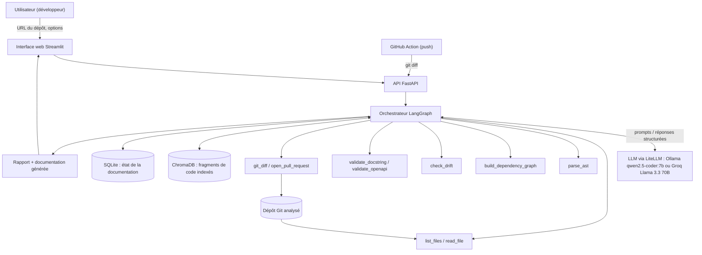

# DocAgent – Agent de documentation automatique

> Projet n°14 · Cours *Développement et déploiement d'applications intelligentes* · EMSI Casablanca

**Binôme (G2)** : Ilyas Errifay · Othman Raji

**Statut** : 🚧 en cours de développement (phase de cadrage terminée)

---

## Sommaire

1. [Présentation](#présentation)
2. [Fonctionnalités](#fonctionnalités)
3. [Architecture](#architecture)
4. [Dataset](#dataset)
5. [Technologies](#technologies)
6. [Évaluation](#évaluation)
7. [Structure du dépôt](#structure-du-dépôt)
8. [Planning](#planning)
9. [Crédits et licences](#crédits-et-licences)

---

## Présentation

### Le problème

Dans la plupart des projets logiciels, la documentation est **absente** ou **obsolète** :

- les développeurs manquent de temps et repoussent sa rédaction ;
- quand le code change (un paramètre renommé, une fonction supprimée), la documentation n'est pas mise à jour ;
- les nouveaux développeurs perdent du temps à lire le code ligne par ligne, et une documentation fausse provoque des erreurs.

### La solution

**DocAgent** est un agent IA qui analyse un projet Python, **génère sa documentation** (docstrings, README, documentation des API, schéma d'architecture), **détecte les écarts** entre le code et la documentation existante, et **maintient la documentation à jour** à chaque modification du code. Aucune modification n'est appliquée sans la validation de l'utilisateur.

### Utilisateurs cibles

- Développeurs et responsables techniques qui maintiennent un dépôt Python
- Nouveaux arrivants qui doivent comprendre rapidement une base de code existante

---

## Fonctionnalités

| N° | Fonctionnalité | Description | Résultat |
| :-: | :---- | :---- | :---- |
| 1 | **Analyse du projet** | Parcourt le dépôt et extrait fonctions, classes, signatures et imports par analyse statique (le code n'est jamais exécuté) | Inventaire du code + graphe des dépendances |
| 2 | **Génération des docstrings** | Rédige les docstrings manquantes et vérifie qu'elles décrivent exactement les paramètres réels | Docstrings vérifiées avec score de confiance |
| 3 | **Documentation des API et README** | Décrit les endpoints des applications FastAPI/Flask au format OpenAPI et rédige un README à jour | `openapi.yaml`, `README.md` |
| 4 | **Explication de l'architecture** | Résume le rôle de chaque module et génère un diagramme à partir du graphe de dépendances | Résumé + diagramme Mermaid |
| 5 | **Détection des écarts et mise à jour continue** | Repère les écarts code/documentation et ne réanalyse que ce qui a changé (`git diff`) ; propose les corrections via une Pull Request | Rapport d'écarts + Pull Request |

Le détail de chaque fonctionnalité (entrées, sorties, outils, exemples) est disponible dans [`docs/Errifay-Raji_Projet14_fonctionnalites.md`](docs/Errifay-Raji_Projet14_fonctionnalites.md).

### Aperçu de l'interface


---

## Architecture



**Fonctionnement** : l'orchestrateur LangGraph enchaîne les étapes *analyse → planification → génération → vérification*. Les outils déterministes (analyse syntaxique, graphe de dépendances, détection d'écarts, validation) garantissent la fiabilité ; le LLM se charge de la rédaction. ChromaDB permet de retrouver le contexte utile d'une fonction, et SQLite conserve une empreinte de chaque élément pour le mode incrémental.

---

## Dataset

📁 [`data/dataset_documentation_code.csv`](data/dataset_documentation_code.csv)

| Élément | Valeur |
| :---- | :---- |
| Taille | 2 108 lignes × 23 colonnes (≈ 4,3 Mo) |
| Format | CSV, UTF-8 |
| Source | Code source de 5 bibliothèques Python open source, extrait par analyse statique |
| Génération | Script [`scripts/build_dataset.py`](scripts/build_dataset.py) (graine aléatoire fixée à 42, résultat reproductible) |
| Usage | **Évaluation** de l'agent (l'agent n'est pas entraîné sur ces données) |

### Projets sources

| Projet | Version | Licence | Lignes | Taux de docstrings |
| :---- | :---- | :---- | ---: | ---: |
| requests | 2.32.3 | Apache-2.0 | 289 | 75 % |
| Flask | 3.0.3 | BSD-3-Clause | 412 | 68 % |
| Click | 8.1.7 | BSD-3-Clause | 559 | 43 % |
| HTTPX | 0.27.2 | BSD-3-Clause | 564 | 44 % |
| FastAPI | 0.115.0 | MIT | 284 | 25 % |

### Contenu

Chaque ligne correspond à une **fonction**, une **méthode** ou une **classe** :

| Colonne | Description |
| :---- | :---- |
| `id` | Identifiant unique (`DOC-00001` à `DOC-02108`) |
| `projet`, `version`, `licence`, `fichier` | Origine de l'élément |
| `nom_qualifie`, `type_element` | Nom complet (ex. `Context.invoke`) et type (`fonction`, `methode`, `classe`) |
| `signature_originale`, `signature_courante` | Signature réelle et signature après injection éventuelle d'un écart |
| `code` | Code source complet de l'élément |
| `docstring_reference` | Docstring écrite par les mainteneurs (vide si absente) |
| `a_docstring`, `nb_mots_docstring`, `ratio_params_documentes` | Indicateurs sur la documentation existante |
| `ecart_injecte`, `type_ecart` | Étiquette de vérité terrain pour la détection d'écarts |

### Écarts simulés

Pour évaluer la détection d'écarts, **103 incohérences** ont été introduites volontairement : la signature d'une fonction documentée est modifiée sans mettre à jour sa docstring.

| Type d'écart | Nombre |
| :---- | ---: |
| Paramètre ajouté | 63 |
| Paramètre renommé | 20 |
| Paramètre supprimé | 20 |

### Limites

- Python uniquement ; projets de bonne qualité, écrits en anglais
- Écarts limités à la signature (pas de changement de comportement interne)
- Jeu déséquilibré (≈ 4,9 % d'écarts) : évaluation par précision, rappel et F1

---

## Technologies

| Catégorie | Choix |
| :---- | :---- |
| Langage | Python 3.11 |
| Framework d'agents | LangGraph |
| LLM | Qwen2.5-Coder 7B via Ollama (local, par défaut) · Llama 3.3 70B via Groq (option) · LiteLLM |
| Base vectorielle | ChromaDB |
| Mémoire persistante | SQLite |
| Analyse de code | `ast`, `networkx`, `GitPython` |
| Interface / API | Streamlit · FastAPI |
| Tests | pytest, pytest-cov, openapi-spec-validator, ruff |
| Déploiement | Docker, Docker Compose, GitHub Actions |
| Monitoring | Journaux JSON, Langfuse |

---

## Évaluation

| Dimension | Métrique | Objectif |
| :---- | :---- | :---- |
| Détection des écarts | Précision, rappel, F1 sur les 103 écarts | F1 ≥ 0,85 |
| Qualité des docstrings | ROUGE-L, similarité sémantique, note d'un LLM juge + annotation humaine | Exactitude ≥ 4/5 |
| Hallucinations | Paramètres inventés ou oubliés après validation | 0 % |
| Documentation API | Routes couvertes, validité du schéma OpenAPI | 100 % |
| Couverture | Éléments publics documentés après passage de l'agent | ≥ 90 % |

Pour éviter de régler l'agent sur les données de test : **Click et requests** servent à la mise au point, **Flask, HTTPX et FastAPI** au test final.

---

## Structure du dépôt

```
projet/
├── README.md
├── data/
│   └── dataset_documentation_code.csv
├── docs/
│   ├── Errifay-Raji_Projet14.md                  # fiche de cadrage
│   ├── Errifay-Raji_Projet14_fonctionnalites.md  # détail des 5 fonctionnalités
│   └── maquette_DocAgent.png                     # maquette de l'interface
└── scripts/
    └── build_dataset.py                          # génération du dataset
```

Structure prévue pour le code de l'agent (à venir) : `docagent/` (agent et outils), `api/`, `ui/`, `tests/`, `docker-compose.yml`.

### Régénérer le dataset

```bash
mkdir -p wheels sources
pip download --no-deps -d wheels requests==2.32.3 flask==3.0.3 click==8.1.7 fastapi==0.115.0 httpx==0.27.2
for w in wheels/*.whl; do n=$(basename "$w" .whl); mkdir -p "sources/$n"; python -m zipfile -e "$w" "sources/$n"; done
python scripts/build_dataset.py sources data/dataset_documentation_code.csv
```

---

## Planning

| Étape | Responsable | Période |
| :---- | :---- | :---- |
| Cadrage et dataset | Les deux | 04/11 → 13/11/2026 |
| Cœur de l'agent (LangGraph) | Ilyas | 10/11 → 24/11/2026 |
| Outils et mémoire | Othman | 16/11 → 01/12/2026 |
| Interface et API | Othman | 24/11 → 08/12/2026 |
| Tests et évaluation | Ilyas (+ les deux) | 01/12 → 14/12/2026 |
| Conteneurisation et déploiement | Othman | 08/12 → 17/12/2026 |
| Documentation et présentation | Les deux | 14/12 → 21/12/2026 |

---

## Crédits et licences

Le dataset est dérivé du code source des projets suivants, utilisés dans un cadre pédagogique conformément à leurs licences : [requests](https://github.com/psf/requests) (Apache-2.0), [Flask](https://github.com/pallets/flask) (BSD-3-Clause), [Click](https://github.com/pallets/click) (BSD-3-Clause), [HTTPX](https://github.com/encode/httpx) (BSD-3-Clause), [FastAPI](https://github.com/fastapi/fastapi) (MIT).
